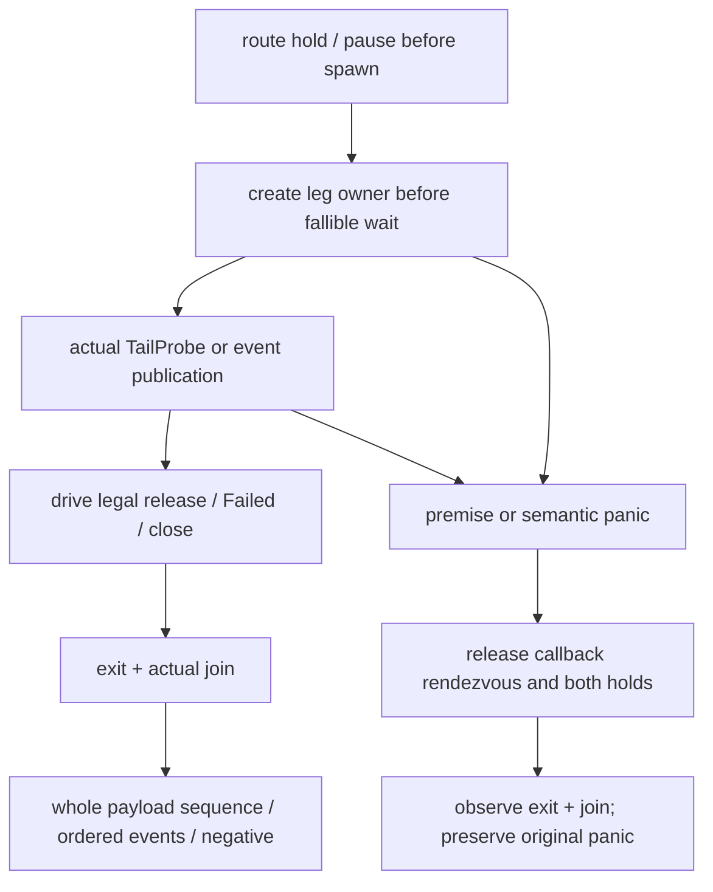
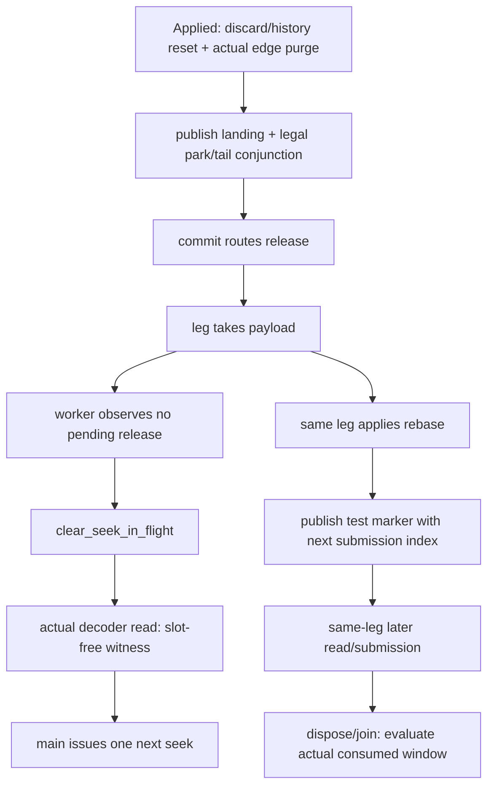

# H0 对抗性复核与修复记录

状态：**执行证据（非产品 authority）**。日期：2026-10-13（Asia/Shanghai）；RUN_ID、运行元数据使用 UTC。

对象：[PR #261](https://github.com/jnhu76/qianqian/pull/261)，任务 [#260](https://github.com/jnhu76/qianqian/issues/260)，方法记录 [#262](https://github.com/jnhu76/qianqian/issues/262)。原分支 HEAD `b002a69370fb623b210c019da096a1fb4a6507e7`；冻结 main `daad414582b2a31eddc4a5b3fdb85bcce4bd60b0`；修复后的 Rust 快照 `6dc80661ee4b27f51ff3f787ef51c3951dd28fc0`。后续 mutation fixture / 证据文档提交不改变该 Rust 快照。

本轮逐条重新分析 18 个 H0 的真实调用链、合法前提、出口、Oracle 和测试拥有的资源，再按性质组修复。**18 个 H0 并不是 18 个生产缺陷**：有语义 Oracle 盲区，也有前提、异常清理或声明范围问题。生产行为、公开 API、ADR、依赖及 CI/门禁规则均未改变；`completion.rs` 的新增代码只在测试模块中。

完整身份、函数体 before/after hash、提交、单项 RUN_ID 和处置见 [18 行 ledger](h0-disposition-ledger.csv)；以下表格是它的中文阅读视图。原执行器的报告保留为历史记录，不能继续把 `b002a69` 的 review approval 当作当前 HEAD 的 approval。

## 18 项性质与路径

| ID | 性质与真实路径 | 前提、合法分支与观察边界 | 修复及证据范围 |
| --- | --- | --- | --- |
| C01 | K0 setup → synthetic Source → PreboundPcmFlow → IdentityStage → VerifyingSink | 全 8 块的返回 arena 身份；有限 deterministic 内容；合法 reborrow、容差内误差与损坏值分别检验 | 原同 arena NaN 可通过；现在真实 consume 拒绝非有限 corruption。保留 all-block 与零分配证据。地址不证明没有 scratch copy-back |
| C02 | synthetic PublishedViews.release_reclaimable → real resource Drop；另一线程 acquire | entry condvar 先证明析构已阻塞，再 probe；正常与 entry/语义断言失败均 release → exit → actual join | owner 在首次 fallible premise 前建立；收集 control/probe。锁内析构仍被有界进展 Oracle 拒绝，失败后两线程确实 join。该机制是候选测试实现，非生产 reclaimer |
| C03 | real RenderGate → pause_park → 第三次 probe Quiesced → release | pause 先于 spawn；真实 quiescence publication 后才 release；结束后完整有序 vector | counts 改为 `[Engaged,TailQuiesced,Disengaged]`，probe 次数精确为 3；前提/语义失败自动释放并 join。交换事件顺序：旧测试绿、新测试红 |
| C04 | 三次 real pause engagement；前两次 Quiesced、第三次一直 Pending | 每次 cycle 各自结算；第三次 actual TailProbe rendezvous → release → join；negative 覆盖退出 | 去掉 50ms negative window；完整 vector 重验。release 出口补发假 TailQuiesced：旧 7/7 绿，新 Oracle 红 |
| C05 | close-before-hold/arrival；real seek park → close wake → abort exit | 前抵达关闭分支没有 event/payload；已 park 的关闭分支有 engagement/disengagement、一次 Aborted | 两分支均保留；真实 entry、完整 payload 序列与 actual join。失败/close 的 release cardinality 也能拒绝重复 dispatch |
| C06 | hold → real seek TailProbe → committed release → disengage → take → callback | routed hold 在 spawn 前；entry witness 先于 release；join 后恰好一次并验证下一次为空 | last-wins Option 改为交付序列；同 payload callback 两次会在原测试上失败 |
| C07 | pause+seek → real pause park/quiescence → mid-park Committed → resume | 同一 pause 持续；callback 真实发生时不能有 Disengaged/SeekEngaged；resume/join 后结算 | 完整交付序列及有序 pause cycle；mid-park semantic assert 的 panic 也由 owner 释放双条件并 join |
| C08 | seek park → Failed probe → disengage → abort callback → report → epilogue | 无 owner release；Failed 必须自行结束；channel report 不等于线程退出 | 收到 report 后先 actual join，再查 Failed、一次 Aborted、完整无 quiescence 事件。重复 failure dispatch 红 |
| C09 | 旧 Committed 尚 pending → new hold reset → real cycle-2 consumer | 在第二个 release 能覆盖旧值之前，证明 pending=true→false；最终消费自己的 Aborted | 新增 reset 边界观察。删除 reset：原 C09 仍绿，新边界断言红。此为 defensive port case，非生产允许覆盖旧 commit 的生命周期 |
| C10 | seek Pending probe 1 → Quiesced probe 2 → real event publication → release | 只发布有序 Seek events，恰好两次 probe；25ms 仅是诊断曝光窗，不建立前提 | 保留真实 quiescence publication；一次 Aborted 的序列检查与 join 补强。不把 pause event 当 seek evidence |
| C11 | real probe → release → exit；额外覆盖 release 落在 Pending/Quiesced callback 内 | callback rendezvous 固定 in-flight 窗口；当前 probe 可以完成，不能新增 exit 后 probe | quiesced 主路径精确一次；新增受控 Pending/Quiesced twin。exit 追加 probe 在 count 2!=1 上红，不用容许 `before+1` 掩盖它 |
| C12 | manual pause evidence → real completion decision → real gate consume | 白盒 commit conjunction；消费 probe 应不 park；不声称经过 decode worker/device | 意外 TailProbe 回 Failed 后同步退出并拒绝 fixture，避免漏 resume 导致永远 park；完整序列拒绝重复交付。两种误 park 均检查，不把 watchdog 当 Oracle |
| C13 | real request → manual current-cycle evidence → decision → gate receipt → clear slot → next request | seek exit 的真实顺序是 Disengaged **先于** payload take；两个动作均先于 slot-free | 修正 fixture/event 顺序和注释；保留 next-cycle latch/park assertions。M8 缺失 reset 被本 H0 的 `landing cannot cross cycles` 捕获；worker purge 另测，不能从白盒 reset 推定 |
| C14 | real H1 → Open sample → existing per-instance FencedRequest → teardown → H2 | 顺序 admission negatives、paused positive；straddle 时除 teardown 外所有拒绝条件为 false | 新 H2 twin 单独击中第二 hold。删单个 H2 teardown predicate 即错 plant 并红；顺序 case 只证明 H1，不能传播到 H2 |
| C15 | actual Session inverses → worker stop/join → gate release → test Output.stop_and_join | real held TailProbe；真实 stop_and_join entry 后才 hostile pause；unhold 后实际完成 disposal/join | 替换 100ms 排序猜测；scoped pauser 全出口 join。删路由 guard 导致需要 5s rescue close，命名进展 Oracle 红；rescue 不能计 PASS。提出用该合法 seam 取代 OQ-1 债务 |
| C16 | real assembly/session → pause established → request_stop → data-plane stop → D11 Fact → dispose | source 无 EOF；actual Paused 前提；Stopped、late commands inert、terminal 不重标 | 保留已修正确的 endless source；加 test-owned disposer。漏记 stop intent 的真实 fault 得到 Failed!=Stopped，确认 terminal Oracle 的非空路径 |
| C17 | actual provider Applied → staging/history discard → edge purge → commit/take → worker clear → decoder read → next cut | pause 连续，source 保持 Open；post-seek read 证明 slot-free；两 cut 之间无 submission；最后 resume/dispose | 移除 200ms settle；两次 on-leg marker 均对应 paused prefix；final 第一帧必须是第二 landing。no-purge 在旧 18/18 集成 suite 存活，在新本 H0 红 |
| C18 | unknown then known Applied → real worker/gate/edge → on-leg rebase → consumed content | worker post-seek read 后单次发 request 2；EOF permission 保证第二 applied marker 后 episode 仍 live | 移除 200ms；live Position 仍 None 后才允许 EOF；join/dispose 后每个非空 cut window 首帧匹配实际 source landing。恢复 known publication：旧测试绿，新 live Oracle 红 |

统一的完整 TEST_ID、源码位置、性质 owner 和 bound 在 CSV/原始 cards 中。上述路径覆盖是**显式枚举的合法分支和代表性 interleaving**，不宣称穷尽所有调度、输入或平台。

## 三个需要分开的执行 DAG

### 1. Park 及异常退出

新 `ProbeRelease` 在 leg owner **之后**声明，使 unwind 先解除 callback rendezvous，再 close/release/join。普通 deadline 是失败界限；它不能证明前提，也不能强制终止任意挂死线程。清理失败须另记，不能把 release 或 OS thread 消失写成 actual join。

Gate 测试另有 12 组 payload × pause × arrival 枚举（Aborted / Committed(None) / Committed(Some)，seek 与 pause attribution，release 在 arrival 前/park 后），以及独立的 pause Failed-probe pending-payload exit：这最后一条不能用普通 mid-park delivery 代替。

### 2. Slot-free 与 callback apply 不同

Seek exit 的 Disengaged 在 take **之前**发布。Worker read 可以发生在旧 callback 应用尚未结束时；它证明 slot 已 free，**不能**被泛化为“所有 cut 动作已结算”。旧 callback 应用和未来 submission 在同一个 leg 上有程序顺序；无需新增产品 apply-ack、epoch 或 slot API。

Marker 在 test render provider 真正应用 rebase **之后**记录。对连续 paused cut，第一 cut 可以在产生任何新输出之前被第二 cut 替代，因此合法消费窗口为空；只要求每个**非空**窗口从该 cut 的实际 source landing 起步，不强迫不可达的中间 audible output。

### 3. Teardown 与 hostile command

`StreamLifecycle` 是 test Output 所拥有的普通观测；QianqianApp 的生产 Drop 契约仍是 explicit dispose。`EpisodeFixture` 只负责测试作用域自己的 root，失败时先 unhold 再调用真实逆链。新的 fixture panic 正控制覆盖已建立 pause 与 held TailProbe 两种退出；删除 disposer 后，即使 Stop rescue 让 OS 线程结束，quiet disposal / actual-join Oracle 仍会失败。

## 修复前后判定

见 [mutation matrix](h0-adversarial-mutation-matrix.csv) 与 [执行索引](h0-adversarial-execution-index.csv)。分类分开保留：

- 原 Oracle 在确实运行目标后仍绿：`ORIGINAL_ORACLE_MUTANT_SURVIVES`。
- 独立/修复 Oracle 命中预登记语义错误：`SEMANTIC_MUTANT_CAUGHT`。
- 已建立合法前提后发生死锁/不进展：`BOUNDED_PROGRESS_MUTANT_CAUGHT`，写明 bound，不能包装成无界 liveness proof。
- fixture 缺 resume / disposer 等故障：`FIXTURE_FAULT_CAUGHT`，不伪装成生产缺陷。
- 编译错误、quality gate failure、patch 无法应用、构建产物身份不确定：单独分类，不计 semantic RED。

新发现的两个 before/after 对照也已执行原 b002 版本：pause 事件调换只保持 counts 会存活；new-hold reset 删除被第二个 Aborted writer 掩盖会存活。Unknown→known publication 的原 b002 测试也存活。后来补强的结果没有覆盖或改写这些旧绿灯。

既有近机制防守须保留：`session::seek_record_tests::stopped_record_has_no_seek_effects_while_open_record_executes_cut` 已能捕获缺 purge；不能把集成层盲区说成全仓库没测。PR #257 的 worker-gone H2/双 hold 负控制，以及 F5 当前 11 个实现 fault，也在本轮重新验证。

## 门禁及平台范围

Rust 快照完整 `lefthook run pre-push --all-files`：workspace **872 passed / 0 failed**（原 b002 为 862，新增 10 个测试），fmt/clippy、commit convention、vocabulary、plugin boundary/negative controls、website verify/build 通过。18 个 H0 另逐项运行，每次 **1 passed**。最终文档 HEAD 的 gate/CI 身份在 PR 回读记录中单独发布，不能拿旧 HEAD 的通过替代新运行。

现有 Rust verification gate：native matrices、Miri、dependent-consumer oracle、kernel mutations、Loom-configured 12-test suite 和 lost-wakeup negative control 通过；native/Miri 另有非空原始输出。TLA/TLC current（K0、realtime publication、D11 settlement、F5 discontinuity）通过，限于该模型/bounds/fairness。它们不证明所有 H0 或真实设备正确。

F5 implementation gate 首次有 **4 个 patch 不能应用**，结果为 TOOLING-FAIL，失败原日志保留。M3/M5/M7/M8 只重定位当前上下文，原 fault 含义未改变；修复后全部 11 个 fault 被捕获。M3 发布时把 context 从 3 行收窄到 2 行以避免 patch 文件 EOF 的空白检查，产生的 fault Rust bytes 相同，并另运行该发布 patch 的负控制。

Windows MSVC all-target cross check：**COMPILE_ONLY_PASS**；不能当 Windows runtime/device PASS。Windows device-free runtime 等待当前 PR GitHub Actions 的真实身份。Linux device/WASAPI、FFI/excluded、macOS/Android/iOS runtime：**NOT_RUN**。Miri 仅覆盖既有 kernel verification harness；Loom 仅覆盖其生产同步切片/配置。Kani symbolic 没有执行。

两个 multicut 原 H0 在 4 个 CPU spinners 下各 replay 12 次，全部通过；spinners 释放并 join。该 24 次是诊断压力证据，不是全部 schedule proof，也不是 retry-on-failure。

## 证据完整性与限制

- [独立修复前审计包](evidence/h0-independent-audit.zip)：18 cards、baseline/head 各 18 单项正控制、原矩阵/全日志、body snapshots、执行 DAG、离线 explorer；原执行器分类为 65 valid / 2 invalid（历史执行计数，不等于完整 binary provenance）。完整 manifest 位于包内。
- [本轮修复证据包](evidence/h0-adversarial-remediation.zip)：每个调用的 argv、subject、工具/环境/平台、实际目标数量、未截断 stdout/stderr、patch/hash、source fingerprints；失败、无效尝试与后续 rerun 均保留。
- CSV 是检索入口，**哈希表不等于原日志镜像**。两个包会随 PR 版本化发布，并提供 SHA256 与 ZIP 内 manifest；源码恢复另有 byte/hash proof。
- 现有聚合 verifier 脚本会抑制/删除部分 child 输出；本轮保存的是这些 gate 实际外部输出，不能称为每个 TLC / 旧 runner 子命令的原始 trace。H0 focused/mutant、补充 native/Miri 调用保留完整原始输出。
- 一次正控制复用了另一 worktree 的 Cargo mutant 库：标记 `INVALID_BUILD_ARTIFACT_IDENTITY` 后排除，再分离 target dir 重跑。仅检查源码 hash 不足以证明实际 binary 身份。旧独立包也使用共享 target，因此本轮把 duplicate seek/pause、NaN、late-tail、no-purge 的关键旧绿灯另在 b002 + 隔离 target 重新执行，当前结论以新复现为基准；后续新增运行同时记录 actual target artifact hash。旧包的 2 次 source identity race 原样保留。
- 初次缺 Duration import、clippy type-complexity、F5 stale patches 均保留失败；不得把编译/工具失败计为性质被捕获。一次旧 M8 apply setup 失败没有产生 test invocation，以事后工具记录单列，不伪造执行时 stderr 镜像。
- 原 Flash executor 的部分外部完整日志仍只有其哈希表可见；本轮自己的复核/修复日志不能被改标成 Flash 原运行。

## 处置与后续 review

18/18 有独立处置。`FIXED_AND_FALSIFIED` 是本地代码/反例/正控制证据状态，`FIXED_HYGIENE_VERIFIED` 是前提/清理修正；二者都不是 architecture acceptance。OQ-1/OQ-6 的先前决定保留为历史，本轮明确提出用现有 provider 生命周期/read seam 的新证据 supersede，不悄悄声称 owner 已撤销 standing。

当前 **G4 两个 fresh-context 独立 review 未执行（NOT_RUN）**；本文的自检不冒充独立 review。PR 保持 Draft，owner Ready/merge 决定未代行，不关闭 #258/#244 等父任务，也不编辑冻结 918 行 inventory。

可迁移方法与后续跨 repo 试点以 [#262](https://github.com/jnhu76/qianqian/issues/262) 为记录入口；本文件仅记录 Qianqian 案例。重点修复顺序是：真实前提 → 正确观察范围/结算 → 独立反例 → 测试拥有资源的异常清理 → 必要的跨层内容边界。不要从新图、测试名、稳定绿灯或 mutation 分数推导新的产品语义。

## G4 审查与 owner 裁决补记（2026-10-13）

> 本节为文档发布（`0058589`）之后追加的补记；上文"当前 G4 两个 fresh-context 独立 review 未执行（NOT_RUN）"是发布时的状态，已被本节取代。原始运行日志、CSV 行、哈希与失败记录一律保持原样；本节只做语义澄清、转移论证与裁决记录，不改写任何既有证据。

### 1. SUBJECT_SHA 与实际源码树身份的区别

- 执行索引 / mutation 矩阵的 `SUBJECT_SHA` 列 = **该次运行发起时的仓库 HEAD 指针**（test-then-commit 工作流：运行先于提交落盘）。它**不是**"该 run 在该 commit 的 clean checkout 上执行"的出处声明。
- 每次 run 的**实际源码身份**以该 run `metadata.json` 内的全仓 `source_hashes`（逐文件 sha256）为准；这是可复原的 ground truth。
- G4 独立复核（Reviewer B）比对结论：101 行中 56 行的测试侧文件内容实际**新于**其 SUBJECT_SHA 标签（运行时工作树领先于当时提交）；18 条最终 H0 正控（settled-head-h0-01..18）的 `source_hashes` 与最终 HEAD 树**0 文件差异**——最终代码状态的逐项执行证据是完整接续的。
- 使用规则：跨 run 比较、复现或引用一律以 `source_hashes` 为准；`SUBJECT_SHA` 仅用于定位运行时点的仓库指针。既有 CSV 行保持历史原样，本列语义以本节声明为准。

### 2. mutation 证据向最终 HEAD 的转移论证与未验证边界

转移前提（G4 两个 reviewer 各自独立字节验证）：

1. 生产 Rust 文件 `daad414 → 0058589` 字节不变（`src/` 下唯一受碰文件 `completion.rs` 的全部 diff hunk 位于 test module 内）；
2. `crates/` 树 `6dc8066 → 0058589` 零差异（最后两个提交仅 F5 patch 重定位与 docs/证据发布）；
3. 18/18 H0 单项正控在实际树内容等于最终 HEAD 时 RUN_PASS；CI 五条 lane 在 `0058589` 全绿。

因此各 catch 运行（`b002a69` 基座 ⊕ patch 同时携带测试升级与生产 fault）中的**生产侧 fault 载体与 landed HEAD 字节等价**，kill 结论可转移到 `0058589`。

**未验证边界（必须保留）**：22 份 semantic catch patch 中仅 7 份经 G4 逐份测试侧等价 diff（覆盖 C14/C17/C18/C03/C09/C06 等载荷性家族），**其余 15 份未逐份验证**——其转移成立依赖上列字节前提，未做 per-file 等价证明；未在 `0058589` 执行原位 mutation rerun。owner 裁决（2026-10-13）：以本节显式归因替代机械重跑，不要求重放全部 mutation。

### 3. G4 与 OQ-1/OQ-6 裁决状态引用

- **G4 双 fresh-context 独立审查已完成**（2026-10-13）：Reviewer A（对抗性 Oracle 与因果正确性）、Reviewer B（架构/权威/证据完整性）均 APPROVE、零事实冲突；reconciliation 裁定 `APPROVE_G4_READY_FOR_OWNER_DECISION`，P0=0 / P1=1 / P2=4。报告位置：Review A = [PR #261 评论 6136250292](https://github.com/jnhu76/qianqian/pull/261#issuecomment-6136250292)；Review B = [PR #261 评论 6136252087](https://github.com/jnhu76/qianqian/pull/261#issuecomment-6136252087)；reconciliation = [#260 评论 6136261985](https://github.com/jnhu76/qianqian/issues/260#issuecomment-6136261985)。
- **Owner 裁决（2026-10-13）**：
  - **OQ-1 / OQ-6 supersession 接受，限定范围**：仅撤销此前相应测试前提上的带债裁决（OQ-1 原 AUTHORITY_BLOCKED、OQ-6 standing debt）；**不扩展**为真实 WASAPI、SongCore ABI、所有平台或所有调度的正确性证明；[#258](https://github.com/jnhu76/qianqian/issues/258) 中其他独立风险（含真机/ABI 类 RHR 项）继续保留。
  - **P1（证据标注语义）处置**：按本补记第 1、2 节显式修正文档与证据归因；原始日志、哈希、失败记录不改写；不重跑全部 mutation；7/22 抽样边界保留声明。
- 本补记即该 P1 的修正记录；merge 授权记录于 PR #261。

### 4. P2 补充说明（不改变原始记录）

- **最终 HEAD 的本地全量 gate**：`20261012T180342-publication-head-full-pre-push`（subject=0058589，`lefthook run pre-push --all-files`，rc=0，workspace 872/0，含 vocabulary / plugin-boundary 负控制、fmt、clippy、website）存在于本地原始运行目录但未纳入 101 行索引与 ZIP；此处引用其 RUN_ID 作为仓库内可引用指针（完整日志见本地证据目录与 #262 回读记录）。
- **历史文档对照**：`h0-final-review-and-gate.md`、`h0-mutant-matrix.md`、`h0-property-graph.md`、`h0-execution-evidence-index.md`、`h0-lessons-learned.md` 为 `b002a69` 阶段历史执行记录：其处置计数 2/13/2/1 与 OQ-1 AUTHORITY_BLOCKED 为当时状态；**当前权威计数为本目录 disposition ledger 的 14/4**。旧 M-P106a"无现测试可杀"陈述已被本轮 C14 straddle 测试与 run `20261012T163012` 超越。
- **F5 refreshed gate**：`20261012T171547` 的 metadata 未将 4 个 `.patch` 输入纳入 `source_hashes`；patch 字节身份经 `refreshed-f5-patches.json` 的哈希记录与仓库文件重算闭环（后续 h0-run.py 宜将 `.patch` 输入一并哈希）。
- **INVALID run 主树状态**：`162418`（INVALID_BUILD_ARTIFACT_IDENTITY）当时 CWD 为主工作树；restore-proof 仅覆盖 mutants worktree，主树当时状态无专门 restoration 记录；主树当前 porcelain 干净为观察现状，非事后证明。
